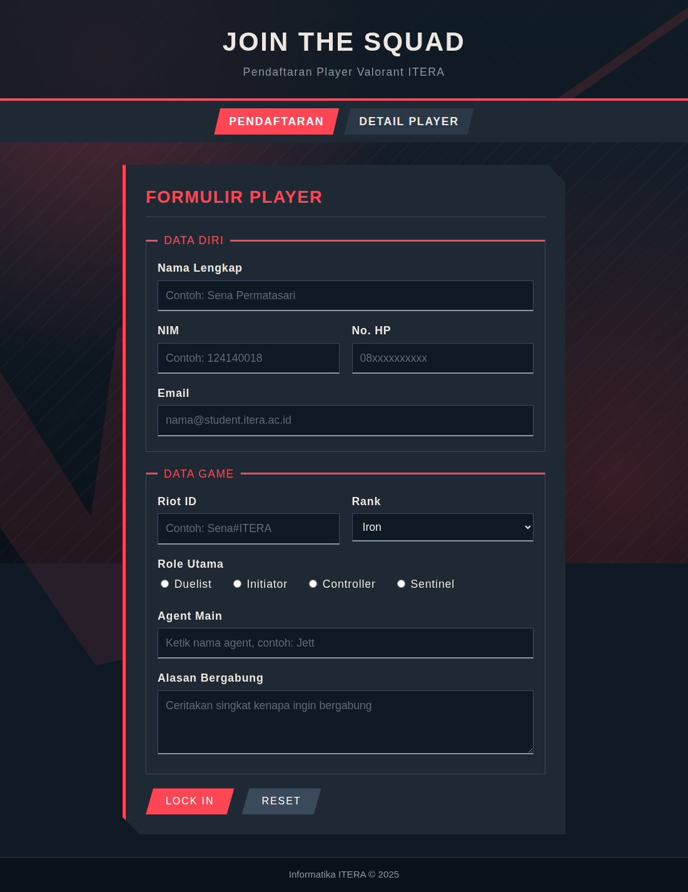
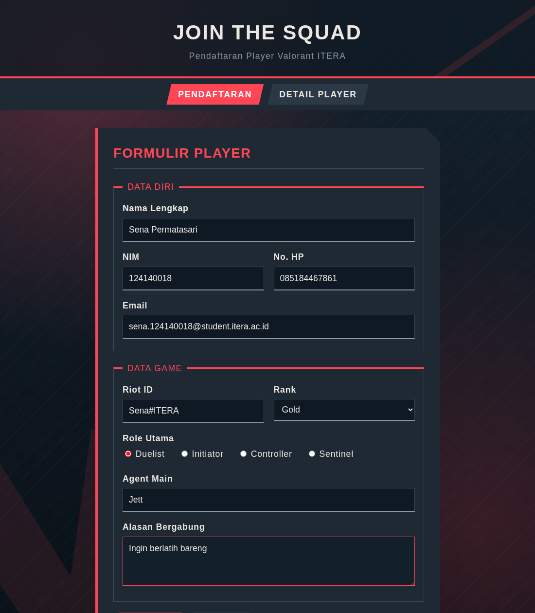
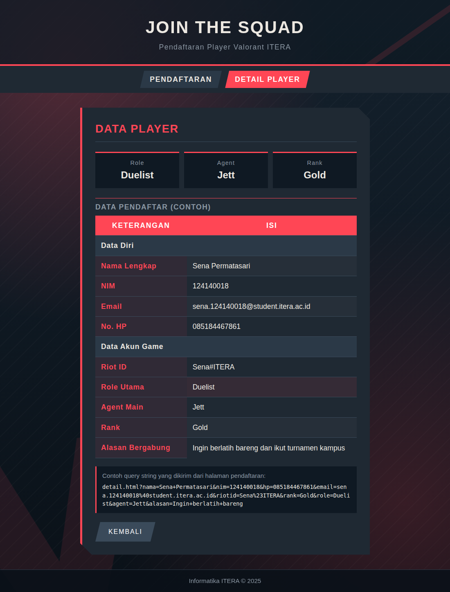
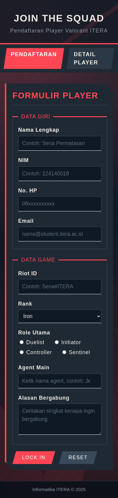

# 🌐 Tugas Pengembangan Aplikasi Web

Kumpulan tugas mata kuliah **Pengembangan Aplikasi Web (PAW)**, Program Studi Teknik Informatika, Institut Teknologi Sumatera.

Repository ini digunakan untuk menyimpan source code, dokumentasi, dan hasil pengerjaan tugas Pengembangan Aplikasi Web. Setiap tugas disusun dalam folder terpisah agar lebih terstruktur dan mudah diakses.

---

## 👩‍💻 Identitas Mahasiswa

| Keterangan | Informasi |
|---|---|
| **Nama** | Sena Permatasari |
| **NIM** | 124140018 |
| **Kelas** | RA |
| **Program Studi** | Teknik Informatika |
| **Institusi** | Institut Teknologi Sumatera |
| **Mata Kuliah** | Pengembangan Aplikasi Web |

---

## 📚 Daftar Tugas

| Tugas | Topik | Folder |
|---|---|---|
| Tugas 2 | Struktur Semantik HTML5 | [Task_2](Task_2/) |
| Tugas 3 | Tabel, Formulir, Layout, dan Web Media | [task_3](task_3/) |

---

## 📌 Deskripsi Tugas

### Tugas 2 – Struktur Semantik HTML5

Tugas 2 berfokus pada penerapan struktur HTML5 semantik dalam pengembangan website profil **Institut Teknologi Sumatera (ITERA)**.

Website terdiri dari dua halaman utama:

- **`index.html`** – Halaman utama yang menampilkan informasi mengenai ITERA.
- **`berita.html`** – Halaman yang menyajikan informasi dan berita kampus.

Dalam tugas ini, struktur HTML disusun dengan memperhatikan penggunaan elemen semantik agar setiap bagian halaman memiliki fungsi yang jelas.

**Fokus pengerjaan:**
- Menggunakan elemen semantik HTML5 seperti `header`, `nav`, `main`, `section`, `article`, dan `footer`.
- Memperbaiki struktur dan penempatan elemen HTML.
- Memastikan setiap tag HTML memiliki pasangan pembuka dan penutup yang sesuai.
- Menyusun hierarki konten agar lebih terstruktur.
- Menerapkan struktur halaman yang konsisten.

**Tujuan:** Menghasilkan halaman website dengan struktur HTML5 yang rapi, semantik, dan mudah dipahami.

📁 **[Lihat Folder Tugas 2](Task_2/)**

---

### Tugas 3 – Tabel, Formulir, Layout, dan Web Media

Tugas 3 berfokus pada pengembangan website **Pendaftaran Workshop Web Development 2026** menggunakan HTML5 dan CSS3.

Website terdiri dari dua halaman utama:

- **`pendaftaran.html`** – Halaman pendaftaran yang menyediakan formulir untuk mengisi data peserta.
- **`detail.html`** – Halaman detail yang menampilkan informasi pendaftaran.

Tampilan website dirancang menggunakan CSS untuk menghasilkan antarmuka yang terstruktur, menarik, dan dapat menyesuaikan ukuran layar.

**Fokus pengerjaan:**
- Membuat formulir pendaftaran menggunakan HTML.
- Menggunakan berbagai jenis elemen input.
- Menampilkan informasi menggunakan tabel HTML.
- Menerapkan CSS selector untuk mengatur tampilan.
- Menggunakan Flexbox dan Grid untuk menyusun layout.
- Mengatur warna, tipografi, dan elemen visual.
- Membuat tampilan yang responsif pada perangkat mobile.

**Tujuan:** Mengembangkan website pendaftaran dengan struktur HTML yang baik serta tampilan yang mudah digunakan.

📁 **[Lihat Folder Tugas 3](task_3/)**

---

## 🖼️ Dokumentasi Tampilan Tugas 3

Berikut merupakan dokumentasi tampilan website pendaftaran Workshop Web Development 2026.

### 1. Halaman Pendaftaran

Halaman utama website yang menampilkan formulir pendaftaran workshop.



### 2. Formulir Pendaftaran

Tampilan formulir ketika data peserta telah diisi.



### 3. Halaman Detail Pendaftaran

Halaman yang menampilkan informasi detail pendaftaran peserta.



### 4. Tampilan Mobile

Tampilan website pada ukuran layar perangkat mobile.



---

## 🗂️ Struktur Repository

```text
TUGAS_PEMWEB_SENA/
│
├── Task_2/
│   ├── Images/
│   │   ├── logo-itera.jpg
│   │   └── ozi-award.jpg
│   ├── index.html
│   └── berita.html
│
├── task_3/
│   ├── SS/
│   │   ├── 01-halaman-pendaftaran.png
│   │   ├── 02-form-diisi.png
│   │   ├── 03-halaman-detail.png
│   │   └── 04-tampilan-mobile.png
│   ├── RA-Sena Permatasari-1241400...
│   ├── README.md
│   ├── detail.html
│   ├── pendaftaran.html
│   └── style.css
│
└── README.md
```

**Keterangan:**

- `Task_2/` – Folder source code Tugas 2.
- `Images/` – Folder gambar pendukung website ITERA.
- `task_3/` – Folder source code Tugas 3.
- `SS/` – Folder dokumentasi screenshot website.
- `pendaftaran.html` – Halaman formulir pendaftaran workshop.
- `detail.html` – Halaman detail pendaftaran.
- `style.css` – File CSS untuk mengatur tampilan website.
- `task_3/README.md` – Dokumentasi khusus Tugas 3.
- `README.md` – Dokumentasi utama repository.

> Catatan: Nama file `RA-Sena Permatasari-1241400...` masih disingkat karena nama lengkapnya tidak terlihat pada screenshot repository.

---

## 🛠️ Teknologi dan Tools

| Teknologi | Kegunaan |
|---|---|
| HTML5 | Menyusun struktur dan konten website |
| CSS3 | Mengatur desain dan tampilan halaman |
| CSS Flexbox | Mengatur tata letak elemen |
| CSS Grid | Membuat layout berbasis grid |
| Visual Studio Code | Editor source code |
| Live Server | Menjalankan website secara lokal |
| Git & GitHub | Version control dan penyimpanan repository |

---

## 🚀 Cara Menjalankan Project

Website dapat dijalankan secara lokal menggunakan browser atau ekstensi Live Server di Visual Studio Code.

### 1. Clone Repository

Buka terminal atau Git Bash, kemudian jalankan:

```bash
git clone https://github.com/sena0616/TUGAS_PEMWEB_SENA.git
```

### 2. Masuk ke Folder Repository

```bash
cd TUGAS_PEMWEB_SENA
```

### 3. Buka Project di Visual Studio Code

```bash
code .
```

### 4. Jalankan Tugas 2

1. Buka folder `Task_2`.
2. Pilih file `index.html`.
3. Klik kanan dan pilih **Open with Live Server**.
4. Website profil ITERA akan terbuka di browser.
5. Untuk melihat halaman berita, buka `berita.html`.

### 5. Jalankan Tugas 3

1. Buka folder `task_3`.
2. Pilih file `pendaftaran.html`.
3. Klik kanan dan pilih **Open with Live Server**.
4. Halaman pendaftaran workshop akan terbuka di browser.
5. Untuk melihat halaman detail, buka `detail.html`.

> **Catatan:** Pastikan ekstensi Live Server sudah terpasang di Visual Studio Code. Alternatifnya, file HTML dapat dibuka langsung melalui browser.

---

## 🎯 Tujuan Pembelajaran

Melalui pengerjaan tugas ini, mahasiswa diharapkan mampu:

1. Memahami dan menerapkan struktur semantik HTML5.
2. Membuat halaman website dengan struktur yang terorganisasi.
3. Mengimplementasikan tabel dan formulir HTML.
4. Menggunakan CSS untuk mengatur tampilan dan layout.
5. Menerapkan desain website yang responsif.
6. Mengelola source code dan dokumentasi menggunakan GitHub.

---

## 🔗 Informasi Repository

**Repository:** [TUGAS_PEMWEB_SENA](https://github.com/sena0616/TUGAS_PEMWEB_SENA)

**GitHub:** [@sena0616](https://github.com/sena0616)

Repository ini dibuat sebagai dokumentasi pengerjaan tugas mata kuliah **Pengembangan Aplikasi Web**.

---

**© 2026 Sena Permatasari — Teknik Informatika, Institut Teknologi Sumatera**
